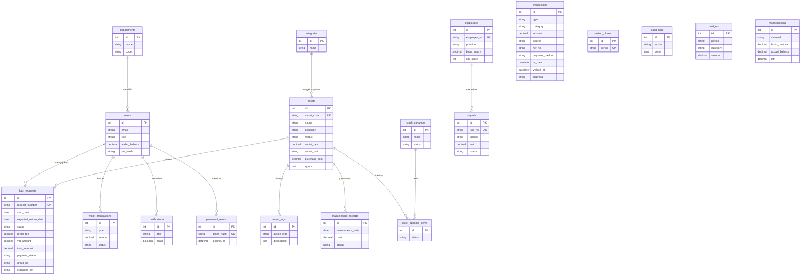

# ERD AsetKu

Diagram dapat dilihat di VS Code (ekstensi *Markdown Preview Mermaid Support*), GitHub, atau mermaid.live.

Catatan: tabel `transactions` (buku kas) mengacu secara logis ke aset (`asset_id`) dan nomor pesanan (`ref_no`) tanpa foreign key, supaya riwayat keuangan tidak ikut terhapus bila data operasional berubah.
