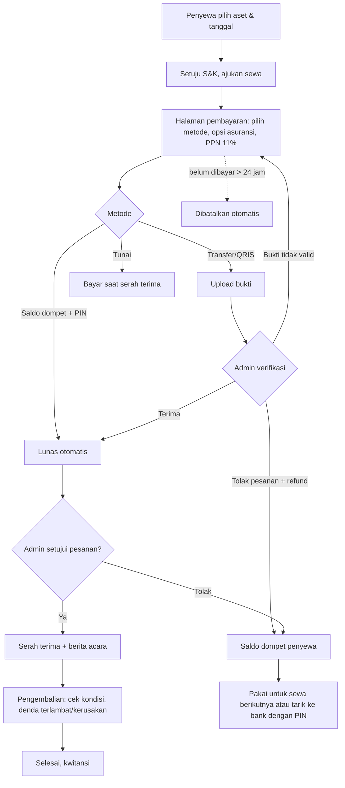

# Use Case dan Alur Sistem

## Aktor dan use case
| Aktor | Use case utama |
|---|---|
| Penyewa | Daftar/masuk, lupa password, melihat katalog + spesifikasi + kalender ketersediaan, scan QR aset, memesan (keranjang), memilih asuransi, membayar (transfer, QRIS, saldo dompet), upload bukti, perpanjang sewa, membatalkan pesanan, melihat riwayat dan kwitansi, kelola dompet dan PIN, tarik saldo |
| Staf gudang | Menyetujui/menolak pesanan, verifikasi bukti bayar, serah terima, pengembalian (kondisi, denda), berita acara, kelola aset (QR, foto, spesifikasi), perawatan, stock opname, proses penarikan saldo |
| Admin | Seluruh fungsi staf, kelola akun dan peran, karyawan dan penggajian, laporan keuangan, persetujuan pengeluaran besar, membuka kembali periode, reset PIN |
| Keuangan | Laporan keuangan, pajak (PPN), anggaran, rekonsiliasi, tutup buku, audit, mencatat transaksi (pengeluaran besar perlu persetujuan admin) |

## Alur sewa dan pembayaran

## Kejadian sistem dan efeknya pada laporan keuangan (bukti pencatatan otomatis)
| Kejadian | Pencatatan otomatis |
|---|---|
| Aset baru dengan harga beli | Uang keluar "Pembelian aset" (investasi) |
| Pembayaran sewa lunas | Uang masuk: pendapatan sewa, premi asuransi, PPN keluaran (dipisah) |
| Denda terlambat / kerusakan | Uang masuk "Denda ..." |
| Perawatan selesai | Uang keluar "Perawatan aset" |
| Pesanan lunas lalu ditolak/dibatalkan | Uang keluar "Refund sewa" + saldo dompet penyewa bertambah |
| Gaji dibayar | Uang keluar "Gaji karyawan" per karyawan |
| Setoran PPN | Uang keluar "Setoran PPN" (mengurangi kewajiban, bukan beban) |
| Akhir bulan | Laporan bulanan dikirim otomatis; periode dapat ditutup buku |
